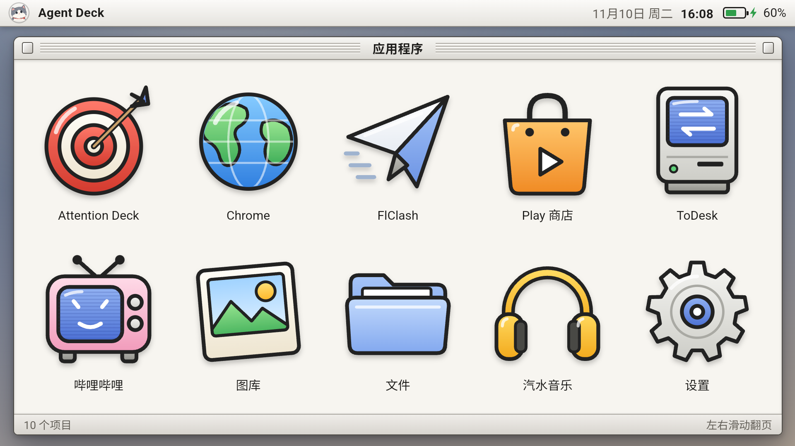
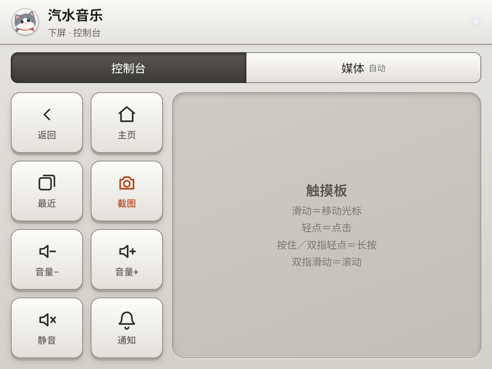
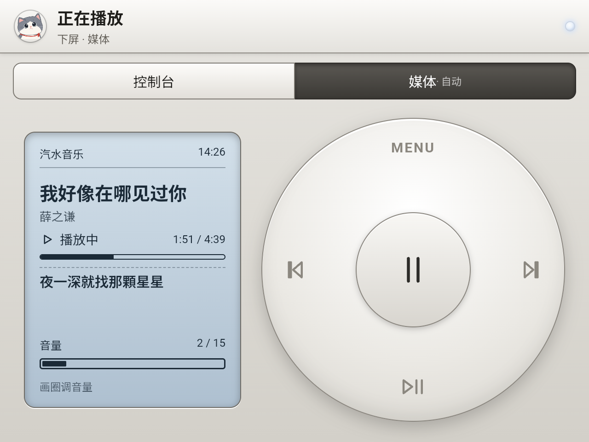
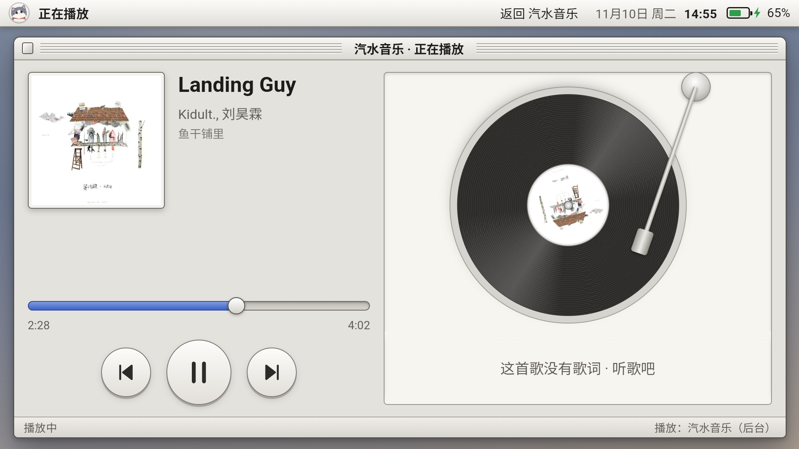

# Agent Deck

把一台 **Retroid Pocket Duo**（上下双触屏掌机）DIY 成随身小电脑：**桌面 + 控制台 + 输入法**，一个 APK 搞定，不需要 root。

上屏放应用，下屏变成它的「副驾驶」——平时是控制台和触摸板，放音乐是 iPod 式转盘，要打字是全尺寸拼音键盘。界面是老 Macintosh 的 Platinum 风格，图标几乎全部手绘矢量。

| 下屏：控制台 + 触摸板 | 下屏：媒体转盘 |
| --- | --- |
|  |  |

## 为什么做这个

安卓对上下双屏几乎没有适配：上下屏图标重复、原生输入法占满整块主屏、音乐 App 卡顿。于是干脆自己重做一层——把下屏变成「副驾驶」，让一台千元掌机当便携电脑用。这也是「注意力管理 / AttentionOS」改造的第一步，后续会继续开源。

## 能干什么

- **上屏桌面**：老 Mac 风格的菜单栏（问候语、日期时间、电量）和「应用程序」窗口，每页 5×2 个图标左右翻页；装卸应用自动刷新。
- **一套手绘图标**：扁平插画风（粗黑描边 + 柔和渐变 + 高光），内置常用 App 专属图标（微信 / QQ / 爱奇艺 / 腾讯视频 / 抖音 / 淘宝 / 支付宝…），并按包名、包名前缀、应用名三级自动匹配到真机上装的 App；其余应用自动套上同风格的铂金底板。
- **下屏控制台**：返回 / 主页 / 最近 / 截图 / 音量± / 静音 / 通知八个键，作用在上屏的应用上。
- **触摸板**：单指滑动移光标、轻点点击、按住或双指轻点长按、双指滑动滚动。
- **媒体转盘**：上屏在放音乐或视频时下屏自动切过去；中心播放暂停、左右切歌、沿着圈转调音量。
- **音乐播放皮**：音乐 App 留在后台播放，上屏换成我们的「正在播放」页（封面、进度、滚动歌词、唱片机动画）。目前针对**汽水音乐**调过，歌词来自 [lrclib.net](https://lrclib.net)。
- **双屏输入法**：应用在上屏，键盘在下屏。拼音词库是雾凇拼音 20 万词 + 用户词库学习；可选语音输入（硅基流动云端识别 + 小模型整理标点和错字）。

## 自带游戏「进击的NPC」

仓库里还带了一个上下双屏的横版小游戏：上屏是游戏画面，下屏是指挥台。它打成一个**独立的 APK**（`tech.foursee.stophero`），跟 Agent Deck 分开装；装上后桌面会自动列出它，点开就能玩。打包、安装、依赖见 [docs/BUILD_CONFIG.md](docs/BUILD_CONFIG.md) 的「游戏」一节。

## 装到你的掌机上

不需要你会敲命令。把**这份仓库**交给你的 AI 编程助手（Claude Code 等），**把这份文档（README）也一起给它**——它会照着 [docs/BUILD_CONFIG.md](docs/BUILD_CONFIG.md) 一步步装好、刷进掌机、并帮你授权。

### 你要先准备（全部要交给 agent）

1. **接线**：在掌机上打开开发者模式 + USB 调试，用数据线连到电脑。
   > 设置 → 关于 → 连点「版本号」→ 打开「USB 调试」→ 数据线连电脑 → 掌机上点「允许」。
2. **你的称呼**：显示在左上角问候语里，比如「小明，晚上好」。
3. **这台设备的名字**：显示在左上角，比如「小明的掌机」；不填就用默认的「Agent Deck」。
4. **硅基流动 API Key**：语音输入用（把你说的语音转成文字）。打开 [cloud.siliconflow.cn](https://cloud.siliconflow.cn) 注册 → 充 10 块 → 建一个 Key（形如 `sk-…`）。不配也能打字，只是不能用语音输入。

### 给 agent 的硬性约束（红线）

> ⚠️ agent 在把代码装进电脑、刷进掌机之前，**必须**先拿到上面的信息——接线确认、称呼、设备名，以及按需的 API Key。**信息没集齐，不允许安装、不允许刷机。**
>
> API Key 等敏感信息只写在本地的 `config.local.json`（已在 `.gitignore` 里），**绝不上传到 GitHub**；打出来的 APK 里含你的 Key，只装自己的设备，不要分发。

## 适用设备

在 **Retroid Pocket Duo Lite（Android 15，未 root）** 上开发和实测：上屏 1920×1080，下屏 1280×960。其他双屏 Android 设备没试过，大概率要改分辨率相关的布局。

## 目录

| 路径 | 内容 |
| --- | --- |
| `android/` | APK 源码：`src/` 是 Java，`web/` 是各界面的网页（WebView 加载），`build.sh` 不用 Gradle 直接打包 |
| `keyboard/` | 键盘界面、拼音引擎、词库、语音输入（模拟器和 APK 共用） |
| `simulator/` | 电脑上的双屏键盘模拟器，双击 `index.html` 打开 |
| `tools/gen_dict.py` | 从雾凇拼音生成 `keyboard/dict.js` |
| `tools/refine-test/` | 比较语音整理模型的效果和耗时 |
| `third_party/rime-ice/` | 雾凇拼音的单字表和许可证 |
| `game/` | 小游戏「进击的NPC」源码：`web/` 页面、`apk/` Android 壳（独立 APK） |
| `docs/` | 打包配置说明（BUILD_CONFIG.md）、开发笔记、截图 |

实现细节、实测数据、踩过的坑都在 [docs/DEV_NOTES.md](docs/DEV_NOTES.md)。

## 许可证

[GPL-3.0](LICENSE)。键盘词库来自 [雾凇拼音 rime-ice](https://github.com/iDvel/rime-ice)（GPL-3.0），APK 里打包了由它生成的 `dict.js`，所以整个项目也用 GPL-3.0。

「Retroid」「汽水音乐」等名称归各自权利人所有，本项目与它们没有关联。
