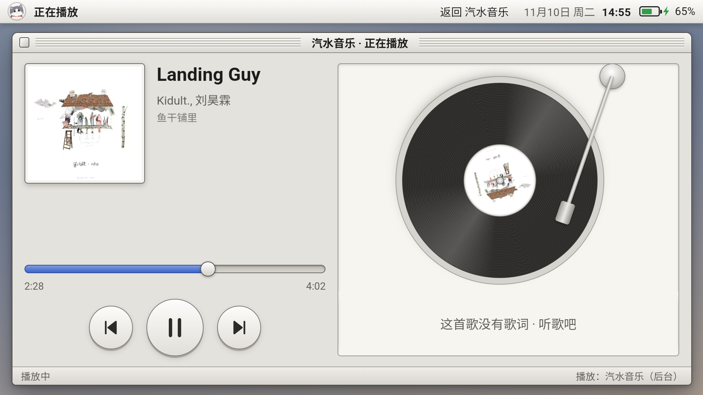
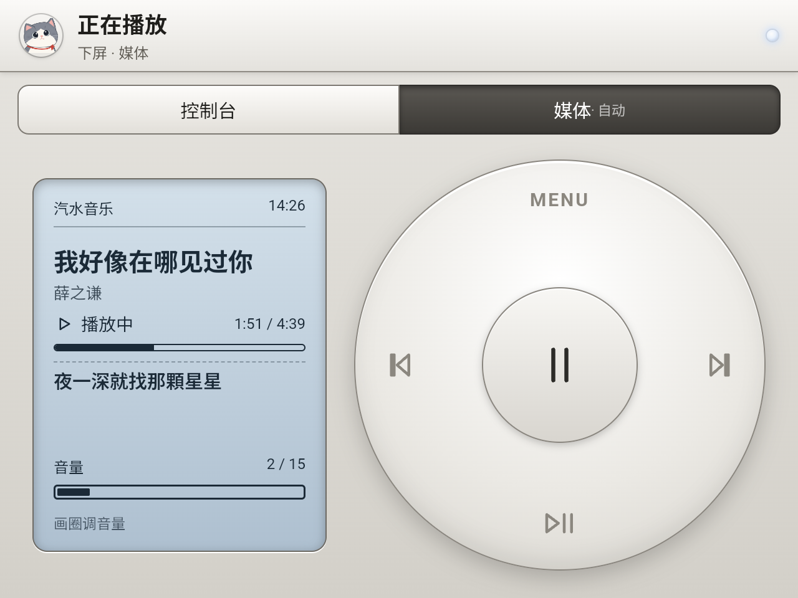

# 开发笔记

> 写给要改代码的人：各模块的实现细节、实测数据和踩过的坑。怎么打包安装看根目录 README 和 [BUILD_CONFIG.md](BUILD_CONFIG.md)。

Retroid Pocket Duo Lite（Android 15，未 root）：上屏（display 0，1920×1080）放应用，下屏（display 2，1280×960，CSS 640×480）放键盘和辅助面板。
整个是一个 APK：包名 `tech.foursee.duoime`，应用名 **Agent Deck**（输入法、上屏桌面、下屏面板、辅助功能都在里面；以前叫“双屏输入法”）。

## 目录

| 路径 | 内容 |
| --- | --- |
| `android/` | 正式版 APK，`bash android/build.sh` 打包 |
| `android/src/.../HomeActivity.java` + `web/home.html` + `web/icons.js` | 上屏桌面（`CATEGORY_HOME`） |
| `android/src/.../LauncherActivity.java` + `web/launcher.html` | 下屏面板（`SECONDARY_HOME`）：控制台 / 触摸板 / 媒体 |
| `android/src/.../DuoIme.java` + `web/ime.html` | 输入法服务：上屏一条窄提示条，键盘在下屏 |
| `android/src/.../DuoAccess.java` | 辅助功能：识别上屏前台应用、触摸板光标和手势、全局动作、粘贴 |
| `android/src/.../DuoNotify.java` | 空的通知监听服务，只为拿到媒体会话（精确控制播放器） |
| `android/src/.../MediaHub.java` `PlayerActivity.java` | 音乐播放皮（见最后一节） |
| `android/src/.../SettingsActivity.java` | 设置页，**不在任何应用列表里**，只用 adb 打开 |
| `keyboard/keyboard.js` `keyboard.css` | 下屏键盘界面（模拟器和 APK 共用），主题 `platinum`（默认）/ `neo` / `light` |
| `keyboard/engine.js` `keyboard/dict.js` | 拼音引擎 + 用户词库；词库是雾凇拼音 rime-ice（**GPL-3.0**），由 `tools/gen_dict.py` 生成 |
| `keyboard/voice-siliconflow.js` | 语音：录音 → 16k WAV → 硅基流动识别 → 小模型整理 → 邮箱名字转拼音 |
| `simulator/index.html` | 电脑上的双屏模拟器，双击打开，不需要服务 |
| `simulator/secrets.local.js` | 模拟器用的本机 API Key，**不入库**（模板 `secrets.example.js`） |
| `config.local.json` | 打包用的个人配置（称呼、API Key、签名），**不入库**（模板 `config.example.json`） |
| `tools/refine-test/test.js` | 比较语音整理模型的效果和耗时：`node tools/refine-test/test.js Qwen/Qwen3.5-9B` |

## 安装和开发

- 打包安装：`bash android/build.sh`，然后 `adb install -r android/build/agent-deck.apk`。
- 工具链：JDK 17 + Android SDK 35，查找顺序见 `android/build.sh` 文件头。Windows 上 aapt2 读不了中文路径，仓库要放在纯英文路径下。
- 首次授权（都用 adb，掌机上不放配置界面）：
  ```
  adb shell ime enable tech.foursee.duoime/.DuoIme && adb shell ime set tech.foursee.duoime/.DuoIme
  adb shell settings put secure enabled_accessibility_services tech.foursee.duoime/tech.foursee.duoime.DuoAccess
  adb shell cmd notification allow_listener tech.foursee.duoime/tech.foursee.duoime.DuoNotify 0
  adb shell cmd package set-home-activity tech.foursee.duoime/.HomeActivity
  adb shell am start -n tech.foursee.duoime/.SettingsActivity --es api_key <你的 Key>     # 可选：覆盖打包时写进去的 Key
  ```
  悬浮窗、麦克风权限在设置页里点，或系统设置里给。
- **每次重装后**：系统可能弹“选择桌面”、下屏会被系统副屏桌面短暂占住。重新执行上面 `ime set` / `allow_listener` / `set-home-activity` 三条，等约 10 秒，确认两块屏：`adb shell dumpsys activity activities | grep topResumed`。下屏还没回来就 `adb shell am start --display 2 -n tech.foursee.duoime/.LauncherActivity`。
- 截图：`adb shell screencap -d <id> -p /sdcard/x.png`，上屏 id `4630947073007009410`，下屏 `4613330929536132356`（不是 0/2）。Git Bash 里要 `MSYS_NO_PATHCONV=1`。
- 调试坑：
  - 这台 ROM 只保留 `Log.e`，日志 tag：DuoIme / DuoLauncher / DuoHome / DuoAccess；JS 的 `console.error` 会转到 logcat。
  - 不要用 `adb shell input keyevent` 往我们的界面发按键，会触发“没有响应”（ANR）。触控测试用 `input -d 2 tap/motionevent`。
  - 脚本循环里调 `adb shell` 要加 `</dev/null`，否则它会吞掉后续输入。
  - 应用不是 debug 包，`run-as` 读不了私有文件。
- 桌面偶尔被系统顶回原生桌面（WebView 卡住）：点下屏控制台的「主页」；还不行就 `am force-stop com.android.launcher3` 再按 Home。

## 上屏桌面（HomeActivity）

风格：**Platinum**，仿老式 Macintosh 的铂金色菜单栏和窗口（之前试过深色霓虹、写实照片图标、像素图标，都没留下）。

- 菜单栏：小猫头像、Agent Deck、问候语（“<称呼>，晚上好。”+ 一句随机的话，30 秒换一句；称呼来自打包配置 `user_name`，没填就不带称呼）、日期时间、**电量**（老 Mac 风格小电池 + 百分比；充电时绿色带闪电，≤20% 变红；30 秒刷新）。桌面隐藏了系统状态栏，所以电量必须自己显示。没有设置按钮。
- 窗口“应用程序”：每页固定 **5 列 × 2 行 = 10 个**，只左右翻页；底部状态栏显示项目数和页码点。
- 隐藏的应用：系统桌面 launcher3、口袋掌游、Agent Deck 自己，以及用户要求隐藏的 **日历、自带音乐、录音机、时钟**（`HomeActivity.HIDDEN`）。
- 安装 / 卸载 / 更新应用后自动刷新列表（package 广播），不用重启。
- 常驻动画都去掉了，省 CPU。

### 图标

- 风格：**扁平插画风**，参考老 Macintosh 插画——粗黑描边（统一线宽 3.2）+ 柔和上亮下暗渐变 + 左上一道白色高光；屏幕类（电视、电脑）带蓝色扫描线。全部是手绘 SVG，在 `android/web/icons.js`，不用生图模型（生成的图风格不统一、还带“AI 生成”水印）。
- 已画 16 个：settings clock files music chrome bili chatgpt todesk gallery calendar recorder store clash qqmusic attention luna。包名 → 图标名的对应在 `home.html` 的 `CUSTOM`。
- 没画过的应用：自动用它自己的图标，放在同风格的铂金圆角底板里（`DeckIcons.tile`）。
- **新装应用想要统一风格**：在 `icons.js` 的 `BODY` 里加一项（viewBox 0 0 100 100，内容留在 4..96，描边用 `O`），再在 `CUSTOM` 里加包名。音乐/视频应用还要加进 `LauncherActivity.MUSIC / VIDEO`，下屏才会切媒体模式。
- 日历图标显示当天日期；没有用苹果的彩虹标、笑脸 Mac 等商标元素。

## 下屏面板（LauncherActivity）

按上屏正在用什么自动切换；顶部两个标签（**控制台** / 媒体）也可以手动点，上屏换应用后回到自动。“控制台”以前叫“伴侣栏”，2026-11-10 起**和触摸板合并**：左边 1/3 是 8 个按键（2 列 × 4 行），右边 2/3 是触摸板，任何界面都能同时用。

| 上屏 | 下屏自动模式 |
| --- | --- |
| 桌面、其他应用（浏览器、ToDesk…） | 控制台：左 8 键（返回、主页、最近、截图、音量−/+、静音、通知）+ 右触摸板 |
| 音乐（QQ音乐、汽水音乐、网易云、Spotify…） | 媒体：iPod 式转盘 |
| 视频（B站、YouTube…） | 媒体：同一套 iPod 转盘（左右 = 上一个/下一个） |
| 输入框获得焦点 | 键盘（输入法盖在面板上） |

风格同样是 Platinum：凸起按键、分段控件；顶部小猫 + 一颗慢慢亮暗的睡眠灯（`steps(14)`，省 CPU）。下屏窗口不抢焦点，上屏应用的焦点和实体键不受影响。

### 媒体：iPod 式转盘

- 左边蓝灰色液晶小屏：当前控制的播放器名、播放中/已暂停、时间、音量条（每秒刷新，实体音量键调的也会显示）。
- 转盘：中心或下方 = 播放/暂停，左右 = 上一首/下一首，上方 MENU = 返回；**手指沿圈转**调音量（约 26° 一格，顺时针加），不弹系统音量条。
- 除视频应用外，媒体模式一律用转盘，**桌面上也是**（回桌面后下屏默认还是控制台，需要手动点「媒体」，用户确认不自动切）。
- 控制谁：上屏是播放器 → 就是它；上屏是桌面或别的应用 → 正在播放的那个音乐播放器，都没在播就是最近用过的那个。
- 实现：走播放器自己的媒体会话（`MediaController`，需要 `DuoNotify` 通知监听授权）。**不要用系统全局媒体键**：它发给“最后用过媒体键”的 App，曾经出现过 QQ 音乐在前台、按播放却放了后台汽水音乐。播放器还没有会话时，把按键直接投给它自己（`ACTION_MEDIA_BUTTON` + `setPackage`）。

### 触摸板

- 单指滑动 = 移动光标；轻点 = 点击；**单指按住不动 / 双指轻点 = 长按**（选中、弹菜单，安卓没有真右键）；**双指滑动 = 上下左右滚动**。
- 没有 root 做不了真鼠标：光标是辅助功能画在上屏的覆盖层，点击和滑动用 `dispatchGesture`（指定 display 0）。
- 右摇杆当鼠标：**放弃**。辅助功能拿不到摇杆模拟量，游戏助手的“虚拟鼠标”是内部服务、调不起来。

## 键盘和语音（DuoIme）

- 主题 `platinum`（默认，和桌面一套）；上屏的窄提示条也是铂金色。
- 拼音：JS 引擎 + 雾凇拼音 20 万词 + 用户词库学习（`files/user.json`）。
- 语音入口：顶栏蓝色“语音输入”点一下开始、点下面“完成”结束；或按住空格说、松开发送，滑出取消。**录音和识别期间顶栏按钮变灰、不可点**，只能用下面的“完成 / 取消”。

### 语音整理（2026-11-10）

识别 → 整理 → 上屏。面板依次显示“正在听… / 识别中… / 整理中…”。

1. 识别：硅基流动 `Qwen/Qwen3-ASR-1.7B`（约 0.8 秒）。
2. 整理：硅基流动 **`Qwen/Qwen3.5-9B`**（约 0.6–0.9 秒，`enable_thinking:false`，temperature 0）。改同音错字；念出来的网址、邮箱、英文还原成书写形式；补标点；去掉“嗯、那个”；“拼音 / 大写”这类口头指令照做。不改原意、不回答问题。提示词在 `voice-siliconflow.js` 的 `REFINE_PROMPT`。
   - 选型实测：Qwen2.5-7B 最快（0.3 秒）但不补标点、不去填充词；Qwen3.5-4B 偶发 56 秒卡顿；Qwen3-30B-A3B 稍慢；Qwen3-8B 被限流。
   - 3.5 秒超时或出错就直接用识别原文；输出比原文长太多（模型在“回答”）也用原文。
3. **邮箱里的中文名转拼音（代码做，不靠模型）**：9B 模型只会照抄提示词里的例子。`fixAccounts()` 把紧挨邮箱或 @ 的中文名（最多 4 个字，往前遇到“是/的/给/邮箱”等就停）用输入法词库转成拼音，取最常用读音；曾、单、解等多音字姓按姓氏读；“汉语拼音 / 拼音”指令词去掉。普通句子里的人名保持中文。
   - 例：唐晓明汉语拼音2024@gmail.com → tangxiaoming2024@gmail.com；小明@2024 → xiaoming@2024；“明天下午苏航来开会”不变。
   - 没覆盖：没有 @ 的账号，如“账号是李雷2024”。
- 换整理模型：`adb shell am start -n tech.foursee.duoime/.SettingsActivity --es refine_model <模型名>`；传 `""` 关闭整理。
- Key 的来源：设置页里填过的（SharedPreferences）优先；否则用打包时从 `config.local.json` 写进 APK 的 `assets/config.json`。仓库里永远不放 Key。

## 音乐播放皮（v1.4.0）

QQ 音乐在这台机器上前台很卡、横屏也没适配。做法：**QQ 音乐留在后台负责播放，界面换成我们自己的**。

实测（Duo Lite / 骁龙 665，QQ 音乐 20.9.8.8）：

| 场景 | CPU（8 核合计，100% = 一个核） |
| --- | --- |
| QQ 音乐在前台（放歌或不放都一样） | QQ 主进程 80%~110% + 系统合成 ~38% |
| QQ 音乐退后台继续放 | QQ 主进程 ~10% + 播放进程 0~7%，后台久了系统会回收它的界面进程（750MB → 260MB） |
| 我们的播放页 + 下屏遥控 + QQ 后台播放 | 整套约 60% |

- **上屏播放页** `PlayerActivity` + `web/player.html`：封面、歌名、歌手、可拖动的进度条、上一首/播放/下一首、滚动歌词（点哪句跳到哪句）。
  - 入口：在 Agent Deck 点 QQ 音乐等音乐 App 的图标，**如果它已在后台（有媒体会话）就打开播放页**，否则照常打开 App 本身。点下屏液晶小屏也能打开。
  - 选歌单还得回 QQ 音乐自己的界面（菜单栏"去 QQ 音乐选歌"）：QQ 音乐没有开放曲库浏览（`MediaBrowserService`），也不支持按歌名搜索播放（`PLAY_FROM_SEARCH`）。汽水音乐有 `MediaBrowserService`，以后可以接它做完整曲库。
  - 看不见时（onStop）停止轮询。注意用 onStart/onStop，不要用 onResume/onPause：双屏机上另一块屏一启动活动，这块就会收到 onPause，回来时不一定再收到 onResume。
- **下屏**：播放页在前台时自动切到媒体模式。转盘左边的液晶小屏显示歌名、歌手、进度和当前这句歌词。
- **数据层** `MediaHub`：选播放器、取歌曲快照（进度按播放速度外推）、封面（JPEG data URL，按歌缓存）、控制指令、歌词。
- **歌词来源，按优先级**：
  1. **QQ 音乐的"车载/蓝牙歌词"**（掌机上已开）：开启后媒体信息变成 标题 = 当前这句歌词、歌手 = "歌名-歌手"。`MediaHub.norm()` 识别并还原：看到 歌手 以 "标题-" 开头，或同一首歌标题在变，就判定是歌词模式（按播放器记住）；歌手字段没有 "-" 时取消。这是 QQ 自己的歌词库，覆盖最全，页面逐句累加显示。
  2. **lrclib.net**（开放的 LRC 歌词库，合规）：带时间轴的整篇歌词，找到就换成整篇滚动。主流中文歌有，部分是繁体；冷门歌和纯音乐常常没有。查到的存在 `files/lyrics/`。
  3. lrclib 只有纯文本歌词：整篇列出，可滑动翻看，不跟拍。
- 省 CPU：下屏的呼吸灯（和键盘上的睡眠灯）改成 `steps(14)`，一秒只换约 3 帧。原来是连续动画，整屏 60 帧重绘，实测要多吃 20% 以上。进度条一秒画一次，歌词只在换行时做一次位移。
- 调试：页面开了 WebView 调试，`adb forward tcp:9333 localabstract:webview_devtools_remote_<pid>` 后用 CDP 可直接在 `player.html` / `launcher.html` 里执行 JS。
- 开发时注意：`adb install -r` 重装后下屏可能退回到别的副屏桌面，用 `adb shell am start --display 2 -n tech.foursee.duoime/.LauncherActivity` 拉回来。




### 歌词补充（2026-11-10）

- **汽水音乐读不到歌词**：设置里“外接设备蓝牙时展示歌词”虽然开着，但媒体信息里始终只有歌名/歌手/专辑（有歌词的歌也试过），不像 QQ 音乐那样把歌词塞进标题。所以只能用 lrclib。
- **只用带时间轴的歌词**。lrclib 的纯文本歌词有挂错歌的（实测 The Pied Pipers《Dream》配成了别的歌），无法核对，已不再使用。
- **没有歌词时右边显示唱片机**（`player.html` 的 `showDeck`）：银色转盘 + 黑胶 + 唱臂，中心贴封面；播放时转、唱臂落下，暂停时停、唱臂抬起。
- 汽水音乐没有 QQ 的“车载歌词”，上面“歌词来源 1”只对 QQ 音乐有效；QQ 音乐已从掌机卸载，桌面上汽水音乐借用了 QQ 音乐的耳机图标。
